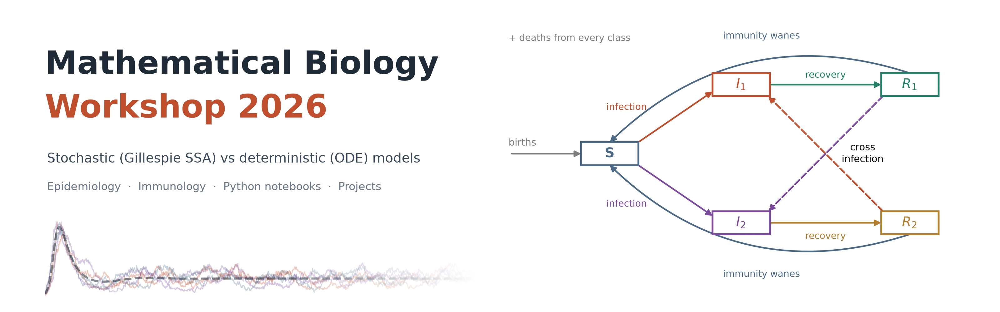

<p align="center">
  
</p>

# Mathematical Biology Workshop 2026

Lecture notes, Python notebooks and project work from the **Training Workshop on Mathematical Biology 2026**.
The common thread is the comparison between **stochastic** models (Gillespie's stochastic simulation algorithm, SSA)
and **deterministic** models (ordinary differential equations, ODE), applied to epidemiology and immunology.

## Contents

| Folder | Topic | What's inside |
|---|---|---|
| [1_Monday - Introduction](1_Monday%20-%20Introduction) | Introduction to modelling | Python basics, Gillespie algorithm for the SIR model (exercises and solutions) |
| [2_Tuesday - Epidemiology](2_Tuesday%20-%20Epidemiology) | Epidemiology | Infected cohort, SIR with constant and dynamic force of infection, chemical master equation |
| [3_Wednesday - Immunology](3_Wednesday%20-%20Immunology) | Immunology | ODE models, enzyme kinetics, receptor–cytokine binding and data fitting, IL-2 model |
| [4_Thursday - Projects](4_Thursday%20-%20Projects) | Group projects | Project statements and the full Project 3 (notebooks, slides, report) |
| [Further Reading](Further%20Reading) | Background | Gunawardena, *Models in biology: "accurate descriptions of our pathetic thinking"* |
| [research_notes](research_notes) | Notes (in French) | Write-up of the Project 3 reasoning, with figures |

## Project 3: Does the disease survive?

*Stochastic versus deterministic models of endemic and multi-strain infections.*

- **Part 1: one strain with waning immunity (SIRS).** The ODE predicts that the infection settles at an endemic
  equilibrium as soon as the population exceeds a critical size. Repeated Gillespie runs show that in small and
  medium populations the infection very often fades out by chance, long before the ODE would suggest.
  → [Project3_Part1_SIRS_SSA_vs_ODE.ipynb](4_Thursday%20-%20Projects/Project3_Part1_SIRS_SSA_vs_ODE.ipynb)
- **Part 2: two strains with cross infection.** The ODE predicts stable coexistence of both strains, while in a finite
  population the stochastic model eventually drives both strains to extinction, and zero is an absorbing state.
  → [Project3_Part2_TwoStrain_SSA_vs_ODE.ipynb](4_Thursday%20-%20Projects/Project3_Part2_TwoStrain_SSA_vs_ODE.ipynb)

Deliverables: [report (PDF)](4_Thursday%20-%20Projects/report/Project3_Report.pdf) ·
[slides (PDF)](4_Thursday%20-%20Projects/beamer/Project_3.pdf) ·
[Beamer sources and figure scripts](4_Thursday%20-%20Projects/beamer)

## Getting started

```bash
pip install numpy scipy matplotlib pandas sympy jupyter
jupyter notebook
```

Then open any `.ipynb` file. Each day's folder can be followed independently.

## Credits and license

Lecture slides, exercise notebooks and project statements were provided by the workshop instructors and remain
their property; they are shared here for learning purposes. The [MIT license](LICENSE) covers my own work
(Project 3 code, slides, report, notes and the banner).
